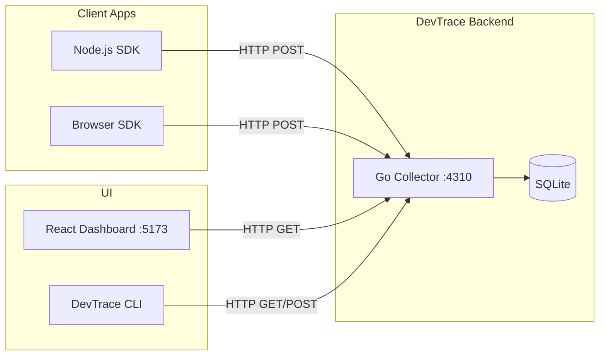

# DevTrace ⚡

DevTrace is a lightweight, self-hosted observability platform built for local development and small-scale deployments. It provides application logging, error tracking, distributed tracing, and visual analytics out of the box with zero external dependencies.

---

## 🏗 Architecture

DevTrace follows a modern decoupled architecture:



---

## 🚀 Quick Start

### 1. Start the Collector (Backend)
The collector runs a fast Go server on port `4310` and uses an embedded SQLite database.
```bash
cd collector
go run cmd/devtrace-collector/main.go
```

### 2. Start the Dashboard (UI)
The dashboard is a responsive React application built with Vite and styled with TailwindCSS (Vuexy theme).
```bash
cd apps/dashboard
npm run dev
```
Open `http://localhost:5173` in your browser.

---

## 📦 SDK Integrations

DevTrace supports auto-instrumentation for popular frameworks.

### Express.js

```typescript
import express from 'express';
import { DevTrace, devtraceExpressMiddleware, devtraceExpressErrorHandler } from '@devtrace/node-sdk';

const app = express();
const devtrace = new DevTrace({ projectId: 'your-project-id' });

// 1. Request Tracking (Trace spans)
app.use(devtraceExpressMiddleware(devtrace));

app.get('/', (req, res) => {
    devtrace.log('Handled request', { severity: 'info' });
    res.send('Hello World');
});

app.get('/error', (req, res) => {
    throw new Error('Something broke!');
});

// 2. Error Tracking
app.use(devtraceExpressErrorHandler(devtrace));

app.listen(3000);
```

### Fastify

```typescript
import Fastify from 'fastify';
import { DevTrace, devtraceFastifyPlugin } from '@devtrace/node-sdk';

const fastify = Fastify();
const devtrace = new DevTrace({ projectId: 'your-project-id' });

fastify.register(devtraceFastifyPlugin, { client: devtrace });

fastify.get('/', async (request, reply) => {
    return { hello: 'world' };
});

fastify.listen({ port: 3000 });
```

### React / Browser

```tsx
import { ErrorBoundary } from '@devtrace/browser-sdk';

function App() {
  return (
    <ErrorBoundary projectId="your-project-id">
      <MyComponent />
    </ErrorBoundary>
  );
}
```

---

## 🛠 Command Line Interface (CLI)

Manage your local environment straight from the terminal.

```bash
# Check collector status and database size
devtrace status

# Stream events in real-time (polling)
devtrace logs --filter error

# List all projects
devtrace projects

# Create a new project space
devtrace create-project --name "My Next.js App"

# Wipe all local events
devtrace clear
```

---

## 📊 Dashboard Features

1. **Live Timeline:** Real-time feed of all incoming logs, errors, and traces.
2. **Analytics Heatmaps:** 24-hour visual trend data by severity and service.
3. **Distributed Tracing:** Jaeger-style waterfall views of parent/child HTTP requests and internal spans.
4. **Rich Error Detail:** Deep-dive modal into stack traces, environment variables, and request metadata.
